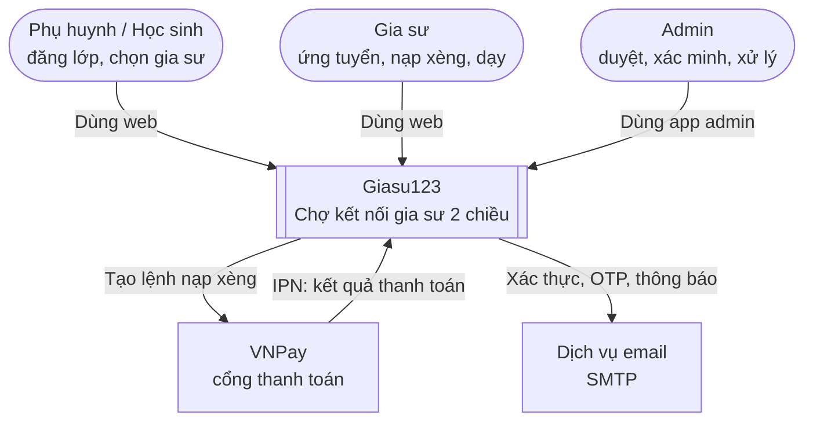
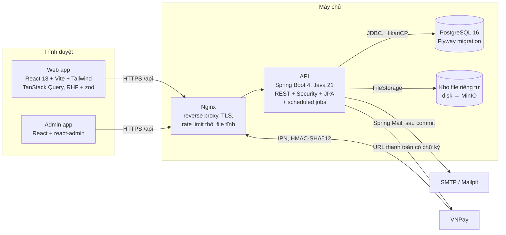
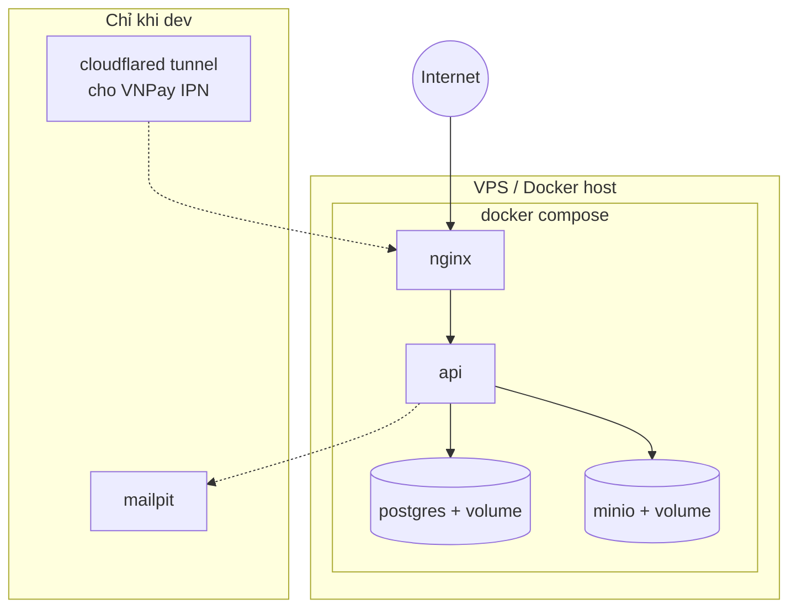

# 01 — Kiến trúc tổng thể (C4)

Mô hình C4 "phóng to" hệ thống qua từng tầng, giống như zoom bản đồ:
- **Context:** Giasu123 là một hộp đen, nhìn xem ai và hệ thống nào tương tác với nó.
- **Container:** mở hộp đen ra, thấy các ứng dụng và kho dữ liệu bên trong.
- **Deployment:** các container đó chạy ở đâu.

Tầng Component nằm ở [05-backend.md](05-backend.md).

> Sơ đồ vẽ bằng `flowchart` thay cho cú pháp `C4Context` của Mermaid, vì cú pháp C4 vẫn đang ở dạng thử nghiệm và hiển thị kém ổn định.

## 1. Context

## 2. Container

| Container | Trách nhiệm | Không làm |
|-----------|-------------|-----------|
| Web app | Giao diện cho khách, thành viên, gia sư; validate form để trải nghiệm tốt hơn | Không chứa luật nghiệp vụ nào mang tính bắt buộc |
| Admin app | Hàng đợi việc, duyệt lớp, xác minh, shortlist, báo cáo, rút xèng, cấu hình | Không truy cập DB trực tiếp |
| Nginx | TLS, cùng một origin cho `/` và `/api`, `limit_req`, security headers | Không có logic ứng dụng |
| API | Toàn bộ luật nghiệp vụ, phân quyền, máy trạng thái, sổ cái ví, jobs | Không lưu session (stateless, trừ bảng `refresh_tokens`) |
| PostgreSQL | Nguồn sự thật; ràng buộc là lớp bảo vệ cuối | — |
| Kho file | Lưu ảnh giấy tờ, không truy cập công khai; chỉ đọc qua API có phân quyền | Không phục vụ file trực tiếp ra ngoài |

**Quy ước cùng origin:** cả hai app đều gọi `/api` trên **cùng domain** với chính nó. Khi dev dùng Vite proxy, khi chạy thật dùng Nginx. Nhờ vậy cookie refresh `SameSite=Strict` hoạt động bình thường mà không phải nới lỏng CORS.

## 3. Triển khai (logic, chi tiết sẽ bàn ở giai đoạn Deploy)

- `admin.giasu123.vn` và `giasu123.vn` là hai server block của Nginx. App admin có thể giới hạn IP.
- API **stateless**, nên có thể chạy nhiều instance phía sau Nginx. Khi đó cần bật **ShedLock** để job không chạy trùng, và chuyển rate limit sang kho dùng chung.
- Backup: `pg_dump` hằng ngày cộng với snapshot volume. Chi tiết để giai đoạn Deploy.
