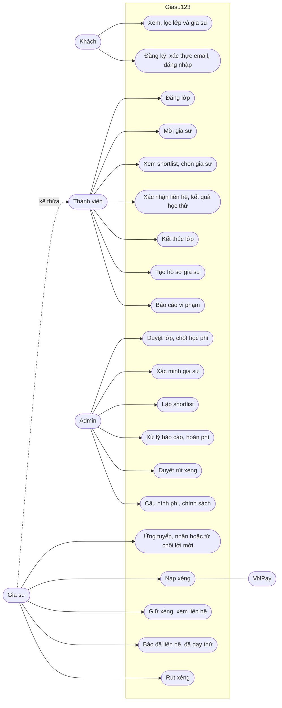

# 02 — Use case

> Mermaid không có loại sơ đồ use case riêng. Ở đây dùng `flowchart` để giả lập: actor nằm ngoài, `subgraph` là ranh giới hệ thống, còn các hình bo tròn là use case.

## 1. Sơ đồ use case (R1)

**Gia sư kế thừa Thành viên.** Một gia sư giỏi Toán vẫn có thể đăng lớp tìm gia sư Tiếng Anh cho chính mình. Tuy vậy, hệ thống **cấm gia sư ứng tuyển vào lớp do chính mình đăng**.

## 2. Bảng use case theo lát

| ID | Use case | Actor | Lát | Trạng thái |
|----|----------|-------|-----|-----------|
| UC1 | Xem, lọc danh sách và chi tiết lớp/gia sư | Khách | R1a | 📐 |
| UC2 | Đăng ký (clickwrap), xác thực email, đăng nhập, đăng xuất | Khách | R1a | 📐 |
| UC3 | Đăng, sửa, đóng, gia hạn lớp | Thành viên | R1a | 📐 |
| UC8 | Tạo, gửi hồ sơ gia sư để xác minh | Thành viên | R1a | 📐 |
| UC15 | Duyệt lớp: gọi xác nhận, chốt học phí, sửa tên gọi; hoặc từ chối | Admin | R1a | 📐 |
| UC16 | Xác minh hoặc từ chối hồ sơ gia sư | Admin | R1a | 📐 |
| UC9 | Ứng tuyển, rút đơn, nhận hoặc từ chối lời mời | Gia sư | R1b | 📐 |
| UC4 | Mời gia sư vào lớp đang mở | Thành viên | R1b | 📐 |
| UC17 | Lập shortlist Top 2–3 kèm lý do | Admin | R1b | 📐 |
| UC5 | Xem shortlist, chọn gia sư, yêu cầu đổi danh sách | Thành viên | R1b | 📐 |
| UC10 | Nạp xèng qua VNPay | Gia sư, VNPay | R1c | 📐 |
| UC11 | Giữ xèng khi được chọn, xem thông tin liên hệ | Gia sư | R1c | 📐 |
| UC12 | Báo "đã liên hệ / không liên lạc được", báo "đã dạy thử" | Gia sư | R1c | 📐 |
| UC6 | Xác nhận đã liên hệ được; báo kết quả học thử | Thành viên | R1c | 📐 |
| UC7 | Kết thúc lớp đang học (gia sư có 48h để phản đối) | Thành viên | R1c | 📐 |
| UC14 | Báo cáo vi phạm | Thành viên | R1c | 📐 |
| UC18 | Xử lý báo cáo, hoàn phí, gọi kiểm tra theo cờ | Admin | R1c | 📐 |
| UC13 | Khai báo tài khoản nhận tiền, yêu cầu rút xèng | Gia sư | R1c | 📐 |
| UC19 | Duyệt rút xèng, đánh dấu đã chuyển | Admin | R1c | 📐 |
| UC20 | Cấu hình `fee_rules`, `refund_policies`, `app_settings`, văn bản pháp lý | Admin | R1a–R1c | 📐 |

## 3. Đặc tả các luồng chính

### UC3 + UC15 — Đăng lớp và duyệt lớp
| Mục | Nội dung |
|-----|----------|
| Tiền điều kiện | Thành viên đã đăng nhập và **đã xác thực email** |
| Luồng chính | 1. Thành viên nhập form lớp (thông tin học sinh, môn, hình thức, số buổi, học phí hoặc "nhờ tư vấn", địa chỉ, yêu cầu). 2. Hệ thống kiểm tra chặn SĐT/link trong ô chữ tự do, lưu lớp ở trạng thái `PENDING_REVIEW`, tự tính `student_display_name`. 3. Admin mở hàng đợi, gọi điện xác nhận với phụ huynh, chốt `approved_fee`, sửa tên gọi nếu cần, bấm Duyệt. 4. Lớp chuyển sang `OPEN`, `expires_at` = +30 ngày, phụ huynh nhận thông báo |
| Luồng thay thế | 2a. Ô chữ chứa SĐT/Zalo → trả lỗi 400 kèm `errors.requirements`. 3a. Không gọi được hoặc thông tin sai → admin Từ chối kèm lý do → `REJECTED`; thành viên sửa rồi gửi lại |
| Hậu điều kiện | Lớp `OPEN` hiện ở danh sách công khai **chỉ với tên gọi và phường/xã**, không có họ tên đầy đủ, số nhà hay SĐT |

### UC9 + UC17 + UC5 — Ứng tuyển, shortlist, chọn
| Mục | Nội dung |
|-----|----------|
| Tiền điều kiện | Gia sư `VERIFIED`, đang có dưới 5 đơn chờ; lớp đang `OPEN`; lớp không phải do chính gia sư đăng |
| Luồng chính | 1. Gia sư gửi ứng tuyển kèm lời nhắn → đơn ở trạng thái `APPLIED`, hệ thống tính `match_score`. 2. Khi lớp có ≥3 đơn hoặc đã mở 48h, lớp xuất hiện trong "Việc cần làm" của admin. 3. Admin chọn 2–3 đơn kèm lý do → các đơn đó thành `SHORTLISTED`, lớp thành `SHORTLISTED`, phụ huynh được thông báo. 4. Phụ huynh chọn một đơn → đơn thành `SELECTED` với hạn giữ xèng 24h; các đơn còn lại thành `NOT_SELECTED`; lớp thành `MATCHING` |
| Luồng thay thế | 4a. Phụ huynh bấm "Đổi danh sách" → lớp quay về `OPEN`, admin lập shortlist mới. 1a. Đã đủ 5 đơn chờ → 409 `APPLICATION_LIMIT` |
| Hậu điều kiện | Mỗi lớp có tối đa một đơn `SELECTED` trở lên. DB đảm bảo điều này bằng partial unique index |

### UC4 — Mời gia sư (chiều B)
Thành viên mời một gia sư `VERIFIED` vào lớp `OPEN` (tối đa 3 lời mời đang chờ) → đơn `INVITED`. Gia sư đồng ý → đơn thành **`SELECTED` luôn**, bỏ qua shortlist. Gia sư từ chối → `DECLINED`.

### UC10 + UC11 + UC12 + UC6 — Giữ xèng, liên hệ, học thử
| Mục | Nội dung |
|-----|----------|
| Tiền điều kiện | Đơn đang `SELECTED`, chưa quá 24h |
| Luồng chính | 1. Gia sư xem chính sách hoàn phí, bấm "Giữ xèng". 2. Nếu thiếu xèng → hệ thống báo "thiếu N xèng" → nạp đúng N qua VNPay → IPN hợp lệ → cộng vào ví. 3. Hệ thống khóa dòng ví, tạo `FeeHold` = 100% phí, ghi sổ cái `HOLD` → đơn thành `CONTACTING`, mở liên hệ cho cả hai bên. 4. Trong 6h, gia sư báo "Đã liên hệ" → đơn thành `TRIAL`. 5. Gia sư bấm "Đã dạy thử" (trong 7 ngày) → phụ huynh có 48h để chọn "Tiếp tục" hoặc "Không phù hợp". 6. "Tiếp tục", hoặc im lặng sau 48h → `CAPTURE` → đơn thành `ACTIVE`, lớp thành `ACTIVE` |
| Luồng thay thế | 1a. Quá 24h chưa giữ xèng → đơn `EXPIRED`, gia sư bị cộng 1 strike, lớp quay về chọn tiếp. 4a. Gia sư báo "Không liên lạc được" → admin gọi phụ huynh → xác nhận sai liên hệ → `RELEASE` 100%, lớp bị khóa hoặc bị báo cáo. 4b. Quá 6h mà gia sư không báo gì → coi như đã liên hệ, **gia sư mất quyền hoàn** nếu sau đó báo không liên lạc được. 5a. Phụ huynh chọn "Không phù hợp" → `RELEASE` theo quota (lần thứ 3 trở đi trong tháng giữ lại 20%) → lớp thành `CANCELLED_AUDIT` |
| Hậu điều kiện | Tổng các bút toán của đơn: HOLD = CAPTURE + RELEASE (+ REFUND nếu có sau này) |

### UC7 — Kết thúc lớp và hoàn phí sau CAPTURE
Phụ huynh bấm "Kết thúc lớp" và nêu lý do → gia sư có 48h để phản đối (nếu phản đối thì tạo báo cáo cho admin) → nếu không phản đối, hệ thống tự hoàn theo `refund_policies`, tính theo số ngày kể từ lúc CAPTURE. Sau 30 ngày, đơn chuyển `COMPLETED` và hết thời gian bảo hành. Nếu gia sư tự bỏ lớp thì không được hoàn, bị 1 strike, và lớp được mở lại với cờ ưu tiên.

## 4. User story mẫu (Given / When / Then → test case)

**US-01 Ẩn dữ liệu học sinh**
- **Given** lớp #L1024 đang `OPEN` của học sinh "Nguyễn Văn An", số nhà "12 Trần Thái Tông"
- **When** khách gọi `GET /api/classes/1024`
- **Then** response có `studentDisplayName = "Bạn An"` và **không có** các trường `studentName`, `addressDetail`, `contactPhone`

**US-02 Không cho hai gia sư cùng được chọn**
- **Given** lớp có đơn A đang `SELECTED`
- **When** phụ huynh (hoặc một request song song) chọn đơn B
- **Then** trả 409 `CLASS_ALREADY_MATCHED`, và DB vẫn chỉ có một đơn `SELECTED`

**US-03 Giữ xèng khi thiếu số dư**
- **Given** gia sư có 500 xèng khả dụng, phí của đơn là 840 xèng
- **When** gia sư gọi "Giữ xèng"
- **Then** trả 409 `INSUFFICIENT_XENG` kèm `shortfall = 340`, và không sinh bút toán nào

**US-04 IPN đến trùng lặp**
- **Given** lệnh nạp T1 đã `SUCCEEDED` và đã cộng 340 xèng
- **When** VNPay gửi lại IPN của T1 lần thứ hai
- **Then** trả `RspCode=02` (đơn đã được xác nhận), và số dư không đổi

**US-05 Phụ huynh im lặng sau học thử**
- **Given** gia sư đã báo "Đã dạy thử" lúc T
- **When** `Clock` tới T + 48h + 1 phút mà phụ huynh chưa phản hồi
- **Then** hold thành `CAPTURED`, đơn và lớp đều thành `ACTIVE`, và hai bên nhận được thông báo

**US-06 Quota hoàn phí**
- **Given** gia sư đã được hoàn 100% hai lần trong tháng này
- **When** lần thứ ba phụ huynh chọn "Không phù hợp"
- **Then** RELEASE 80% và CAPTURE 20%. Nếu báo cáo đã được admin kết luận `FAKE_INFO` hoặc `WRONG_CONTACT` thì được miễn quota
