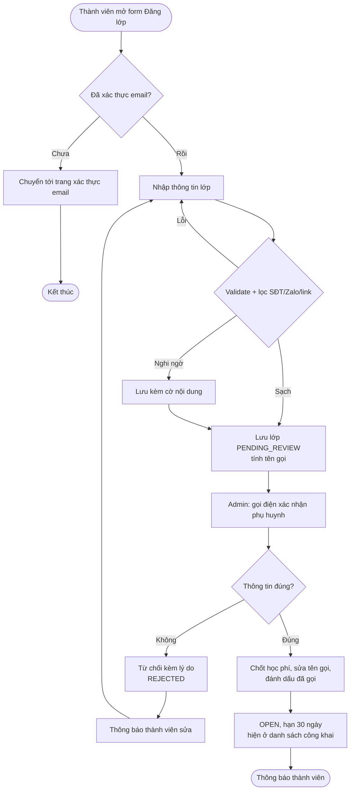
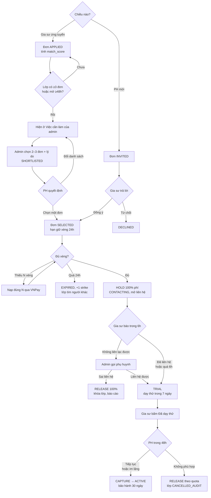
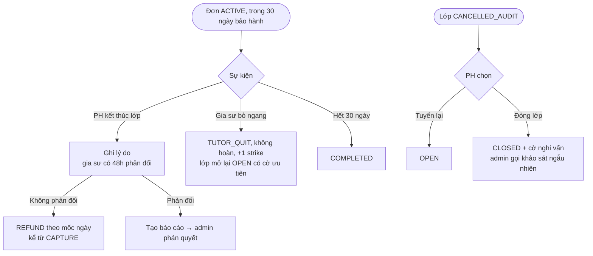
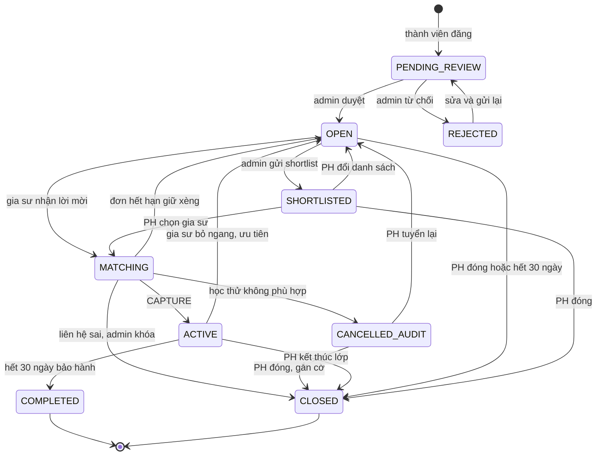
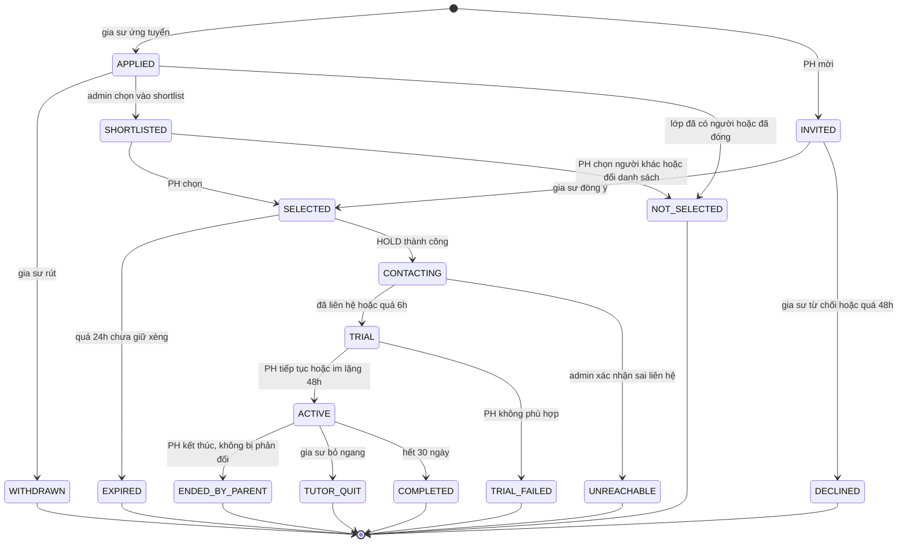
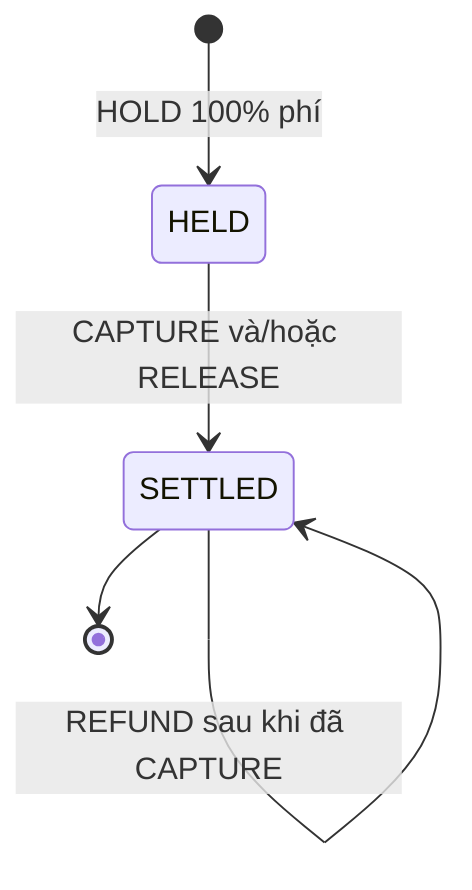
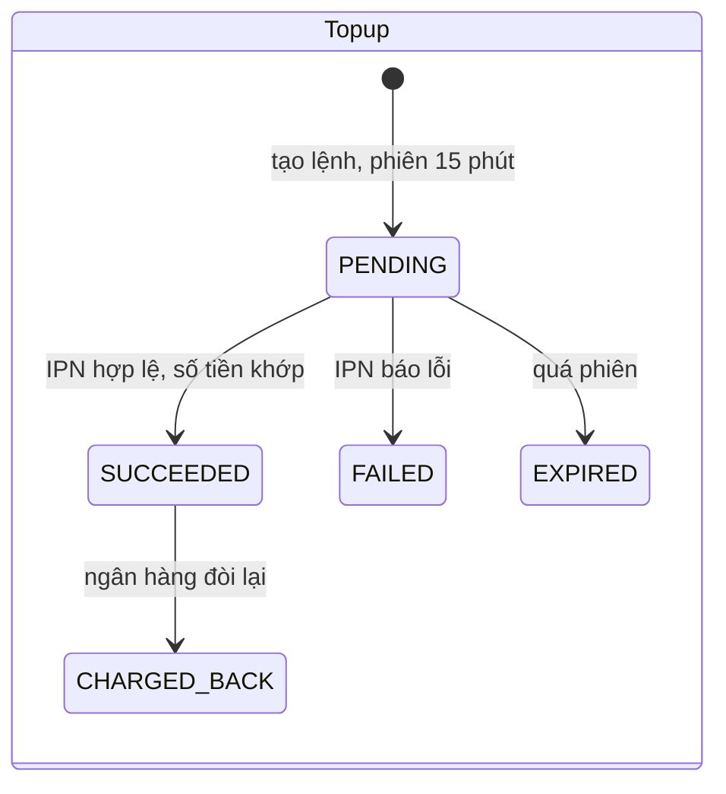
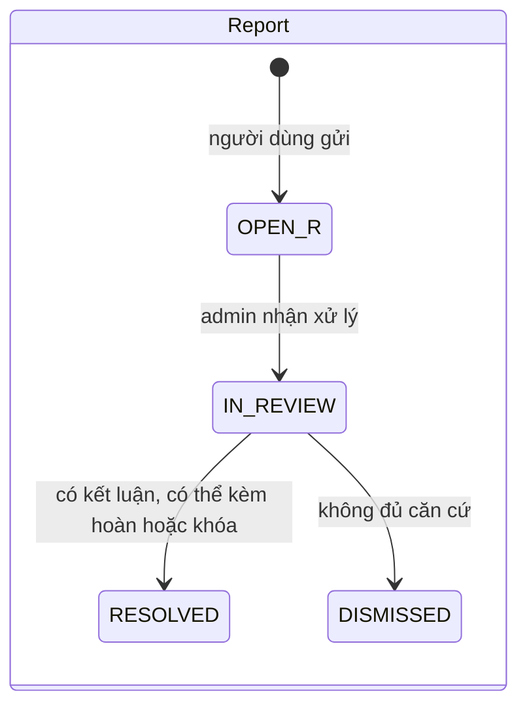
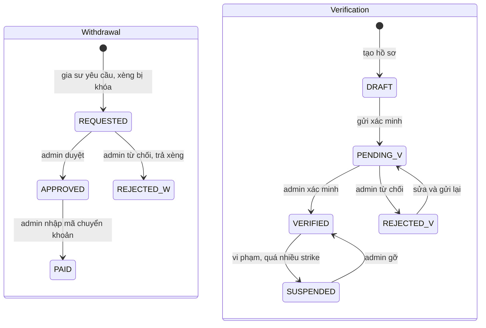

# 03 — Luồng hoạt động và máy trạng thái

**Activity diagram** trả lời câu hỏi: các bước diễn ra theo thứ tự nào, ai làm bước nào.
**State diagram** trả lời câu hỏi: một đối tượng có thể ở những trạng thái nào, và chuyển sang trạng thái khác khi nào.

Mỗi state diagram bên dưới là **nguồn sự thật** cho enum tương ứng trong code: enum có hàm `canMoveTo(...)`, xem [05-backend.md](05-backend.md).

## Nguyên tắc chuyển trạng thái (áp dụng cho mọi máy trạng thái)

1. Enum kiểm tra xem bước chuyển có hợp lệ không.
2. Service ghi bằng **UPDATE có điều kiện**, ví dụ `UPDATE ... SET status = :to WHERE id = :id AND status = :from`. Nếu số dòng bị ảnh hưởng là 0, nghĩa là đã có luồng khác chuyển trạng thái trước → trả 409.
3. Ghi thêm một dòng vào `status_history` (thực thể, từ trạng thái, sang trạng thái, ai làm, ghi chú) **trong cùng transaction**.
4. Gửi thông báo và email **sau khi commit** (`@TransactionalEventListener(AFTER_COMMIT)`).

---

## 1. Activity — Đăng lớp và duyệt lớp

## 2. Activity — Kết nối, giữ xèng, học thử (luồng tiền chính)

## 3. Activity — Sau khi lớp chạy: kết thúc, bỏ ngang, kiểm tra

---

## 4. State — Lớp (`ClassStatus`)

## 5. State — Đơn (`ApplicationStatus`)

"Đơn đang chờ", dùng để tính giới hạn 5 đơn, là các đơn ở trạng thái `APPLIED`, `SHORTLISTED`, `SELECTED`.

> ⚠️ **Cần chủ dự án quyết:** nếu quá 7 ngày ở `TRIAL` mà gia sư chưa bấm "Đã dạy thử", đề xuất là hỏi phụ huynh và đưa vào hàng đợi admin. Admin chọn tiếp tục chờ, hoặc chuyển `TRIAL_FAILED` với tỉ lệ hoàn do admin định.

## 6. State — Khoản giữ phí (`FeeHoldStatus`)

Hệ thống lưu số tiền của từng phần thay vì tạo thêm nhiều trạng thái. Luôn phải đúng **bất biến**:
`held = captured + released` (khi đã SETTLED) và `refunded ≤ captured`.
Ví dụ: hoàn 100% thì captured = 0, released = held. Vượt quota thì captured = 20% và released = 80%.

## 7. State — Lệnh nạp (`TopupStatus`), Báo cáo (`ReportStatus`), Rút xèng (`WithdrawalStatus`), Hồ sơ gia sư (`VerificationStatus`)

`OPEN_R` trong sơ đồ tương ứng với `OPEN` trong code. Tên được đổi chỉ để không trùng với trạng thái của Lớp khi đọc sơ đồ.

---

## 8. Job định kỳ (`@Scheduled`, mỗi phút, dùng `Clock` inject)

| Job | Điều kiện | Hành động |
|-----|-----------|-----------|
| Hết hạn giữ xèng | Đơn `SELECTED` và `hold_deadline < now` | Đơn → `EXPIRED`, +1 strike; lớp `MATCHING` → `OPEN` |
| Hết hạn lời mời | Đơn `INVITED` quá 48h | Đơn → `DECLINED` |
| SLA liên hệ | Đơn `CONTACTING` quá 6h | Đơn → `TRIAL`, đánh dấu `refund_right_lost = true` |
| Tự chốt học thử | `TRIAL` đã có `trial_done_at` và quá 48h | CAPTURE → `ACTIVE` |
| Học thử quá hạn | `TRIAL` quá 7 ngày mà chưa có `trial_done_at` | Đưa vào hàng đợi admin |
| Hết cửa sổ phản đối | Có yêu cầu kết thúc lớp quá 48h mà không bị phản đối | REFUND theo mốc → `ENDED_BY_PARENT` |
| Hết bảo hành | `ACTIVE` quá 30 ngày kể từ CAPTURE | Đơn và lớp → `COMPLETED` |
| Hết hạn lớp | `OPEN`/`SHORTLISTED` và `expires_at < now` | → `CLOSED` |
| Hết phiên nạp | Topup `PENDING` quá 15 phút | → `EXPIRED` |
| Xóa CCCD | Giấy tờ của hồ sơ `VERIFIED` quá 30 ngày | Xóa file, giữ lại metadata |
| Đối soát (hằng ngày) | — | So số dư ví với sổ cái; so tổng TOPUP với các topup `SUCCEEDED`; lệch thì báo admin |

"Nhắc admin khi có ≥3 ứng viên hoặc lớp đã mở 48h" **không cần job**. Đây chỉ là một câu query trên màn "Việc cần làm".
