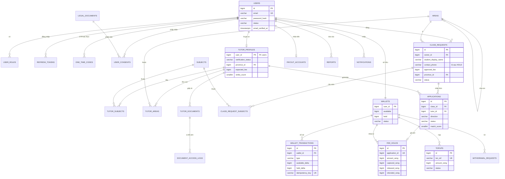

# 04 — Cơ sở dữ liệu (PostgreSQL 16)

## Nguyên tắc
- Schema **chỉ thay đổi qua Flyway migration viết tay**. Không sửa file migration đã chạy. `ddl-auto=validate`.
- Tiền và xèng dùng `BIGINT` (VNĐ hoặc xèng, số nguyên). Phần trăm dùng `NUMERIC(5,2)`. **Không bao giờ dùng `double`** cho tiền.
- Thời gian dùng `TIMESTAMPTZ`. Khóa chính là `BIGINT GENERATED ALWAYS AS IDENTITY`.
- Trạng thái lưu `VARCHAR(30)` kèm `CHECK (status IN (...))`, map với Java enum bằng `@Enumerated(STRING)`.
- **Xóa mềm:** lớp và đơn chỉ đổi trạng thái. Tài khoản bị xóa thì ẩn danh hóa thông tin cá nhân (email → `deleted-{id}@invalid`) nhưng giữ lại giao dịch.
- Ràng buộc ở DB là **lớp bảo vệ cuối**. Service vẫn kiểm tra trước để trả thông báo lỗi dễ hiểu.
- Extension: `unaccent`, `pg_trgm` (tìm kiếm không dấu).

## 1. ERD (các cột chính; danh sách đầy đủ ở mục 2)



Các bảng độc lập (không vẽ quan hệ để sơ đồ dễ đọc): `fee_rules`, `refund_policies`, `app_settings`, `audit_flags`, `status_history`, `shedlock`.

## 2. Danh sách bảng (29 bảng)

### Tài khoản và pháp lý
| Bảng | Cột | Ghi chú |
|------|-----|---------|
| `users` | id, email, password_hash, full_name, phone, status (ACTIVE/LOCKED/DELETED), email_verified_at, created_at, updated_at, deleted_at | UNIQUE `lower(email)`; mật khẩu BCrypt(10) |
| `user_roles` | user_id, role (ADMIN) | PK(user_id, role). TUTOR được **suy ra** từ hồ sơ VERIFIED; mọi user mặc định là MEMBER |
| `refresh_tokens` | id, user_id, token_hash, family_id, expires_at, revoked_at, replaced_by_id, created_at, ip, user_agent | Chỉ lưu **hash**. `family_id` để thu hồi cả chuỗi khi phát hiện token bị dùng lại |
| `one_time_codes` | id, user_id, purpose (EMAIL_VERIFY/ADMIN_LOGIN/PASSWORD_RESET), code_hash, expires_at, attempts, used_at, created_at | OTP admin: hạn 5 phút, tối đa 5 lần thử, dùng một lần |
| `legal_documents` | id, type (TERMS/PRIVACY/TUTOR_RULES), version, content_md, effective_at | UNIQUE(type, version) |
| `user_consents` | id, user_id, document_id, accepted_at, ip, user_agent | UNIQUE(user_id, document_id) |

### Danh mục
| Bảng | Cột | Ghi chú |
|------|-----|---------|
| `areas` | id, parent_id, level (PROVINCE/DISTRICT/WARD), code, name | Cây phân cấp chứa được **cả hai chuẩn địa giới** (3 cấp hoặc 2 cấp). UNIQUE(code) |
| `subjects` | id, name, slug | 10 môn + mở rộng về sau |

### Gia sư
| Bảng | Cột | Ghi chú |
|------|-----|---------|
| `tutor_profiles` | user_id (PK, FK), full_name, gender, birth_year, avatar_key, phone, tutor_type (SINH_VIEN/GIAO_VIEN/NGUOI_DI_LAM), school_or_workplace, bio, experience_years, teaches_online, teaches_offline, province_id, expected_fee, verification_status, verified_by, verified_at, verify_note, strike_count, apply_banned_until, created_at, updated_at | Nội dung `bio` đi qua bộ lọc chặn né phí |
| `tutor_subjects` | tutor_id, subject_id | PK cả hai cột |
| `tutor_areas` | tutor_id, area_id | Các khu vực dạy được (khi dạy offline) |
| `tutor_documents` | id, tutor_id, doc_type (CCCD_FRONT/CCCD_BACK/STUDENT_CARD/DEGREE/OTHER), storage_key, content_type, size_bytes, uploaded_at, deleted_at | `storage_key` là tên ngẫu nhiên, **không phải URL công khai**. File CCCD bị xóa sau 30 ngày kể từ khi VERIFIED |
| `document_access_logs` | id, document_id, viewer_id, viewed_at, ip | Ghi lại mỗi lần admin xem giấy tờ |

> ⬜ **Đề xuất bổ sung từ frontend (2026-10-12, chờ duyệt khi viết `V1__init.sql`):**
> - `class_requests.schedule_note VARCHAR(200)` — "Thời gian học mong muốn" (vd "Tối thứ 2, 4, 6"); gia sư cần thông tin này nhất khi nhận lớp. Đi qua ContentGuard.
> - `tutor_profiles.min_grade`, `max_grade SMALLINT CHECK (1 ≤ min_grade ≤ max_grade ≤ 12)` — lớp gia sư dạy được; dùng để lọc `?grade=` trên `/tutors` và chấm điểm shortlist.

### Lớp và đơn
| Bảng | Cột | Ghi chú |
|------|-----|---------|
| `class_requests` | id, owner_id, student_name, **student_display_name**, student_gender, parent_name, contact_phone, grade, study_mode (ONLINE/OFFLINE), sessions_per_week (1–7), minutes_per_session, fee_mode (FIXED/CONSULT), proposed_fee, approved_fee, province_id, area_id, address_detail, requirements, other_subject_note, preferred_tutor_gender (ANY/MALE/FEMALE), preferred_tutor_type (ANY/SINH_VIEN/GIAO_VIEN), status, priority, content_flagged, called_parent_at, reviewed_by, reviewed_at, reject_reason, published_at, expires_at, created_at, updated_at | 🔒 `student_name`, `parent_name`, `contact_phone`, `address_detail` chỉ trả ra sau HOLD. `province_id` được **lưu lặp** từ `area_id` để đánh index lọc |
| `class_request_subjects` | class_id, subject_id | |
| `applications` | id, class_id, tutor_id, direction (APPLY/INVITE), status, message, match_score, shortlist_note, shortlisted_at, selected_at, hold_deadline, contacted_at, refund_right_lost, trial_done_at, captured_at, end_requested_at, end_reason, objection_deadline, ended_at, created_at, updated_at | UNIQUE(class_id, tutor_id). Luật "gia sư ≠ chủ lớp" được kiểm tra ở service và có test riêng |

### Ví xèng
| Bảng | Cột | Ghi chú |
|------|-----|---------|
| `wallets` | user_id (PK), available, held, status (ACTIVE/FROZEN), updated_at | Số dư lưu sẵn (cache). Luôn `SELECT ... FOR UPDATE` trước khi thay đổi. `available` được phép âm (chargeback), khi đó ví bị FROZEN |
| `wallet_transactions` | id, wallet_id, type, available_delta, held_delta, available_after, held_after, ref_type, ref_id, idempotency_key, note, created_by, created_at | **Chỉ được thêm dòng.** Trigger chặn UPDATE/DELETE |
| `fee_holds` | id, application_id (UNIQUE), wallet_id, base_fee_vnd, fee_percent, amount_xeng, captured_xeng, released_xeng, refunded_xeng, rules_version, status (HELD/SETTLED), created_at, settled_at | Chụp lại (snapshot) % phí và phiên bản nội quy tại thời điểm giữ |
| `topups` | id, wallet_id, amount_xeng, amount_vnd, txn_ref, status, gateway, gateway_txn_no, bank_code, response_code, expires_at, paid_at, created_at | `txn_ref` UNIQUE và ngẫu nhiên, gửi sang VNPay dưới tên `vnp_TxnRef` |
| `payout_accounts` | id, user_id (UNIQUE), bank_code, account_number, account_name, verified_by, verified_at, created_at | Mỗi người một tài khoản nhận tiền. Số tài khoản được che khi hiển thị |
| `withdrawal_requests` | id, wallet_id, payout_account_id, amount_xeng, status, reviewed_by, reviewed_at, transfer_ref, reject_reason, created_at | |

### Vận hành
| Bảng | Cột | Ghi chú |
|------|-----|---------|
| `fee_rules` | study_mode (PK), percent, updated_by, updated_at | ONLINE 30.00 · OFFLINE 40.00 |
| `refund_policies` | id, version, stage (TRIAL/AFTER_CAPTURE), from_day, to_day, refund_percent, effective_at | Xem mục 4 |
| `reports` | id, reporter_id, target_type (CLASS/TUTOR/USER/APPLICATION), target_id, reason, description, priority, status, decision_code, resolution, handled_by, handled_at, created_at | Báo cáo `SAFETY` có `priority` cao nhất |
| `audit_flags` | id, flag_type (CANCELLED_AFTER_TRIAL_CLOSED/CONTENT_SUSPECT/HIGH_REFUND_RATE), target_type, target_id, detail, status (OPEN/CHECKED), checked_by, checked_at, note, created_at | Hàng đợi để admin gọi khảo sát ngẫu nhiên |
| `app_settings` | key (PK), value, description, updated_by, updated_at | Xem mục 5 |
| `notifications` | id, user_id, type, title, body, link, read_at, created_at | |
| `status_history` | id, entity_type, entity_id, from_status, to_status, actor_id, note, created_at | `actor_id` NULL nghĩa là do hệ thống/job |
| `shedlock` | name, lock_until, locked_at, locked_by | Chỉ bật khi chạy nhiều instance |

## 3. Sổ cái ví: mỗi loại bút toán tác động thế nào

Mỗi thao tác tiền = **một transaction**: khóa ví → thêm một dòng `wallet_transactions` → cập nhật số dư lưu sẵn. `idempotency_key` UNIQUE, ví dụ `TOPUP:{txn_ref}` hay `CAPTURE:{hold_id}`, nên xử lý một yêu cầu hai lần cũng không bị cộng/trừ hai lần.

| type | available | held | Doanh thu nền tảng | Khi nào |
|------|-----------|------|-------------------|---------|
| TOPUP | +n | | | IPN hợp lệ |
| HOLD | −n | +n | | Gia sư giữ xèng cho đơn được chọn |
| CAPTURE | | −n | +n | Học thử thành công, hoặc phần 20% bị giữ khi vượt quota |
| RELEASE | +n | −n | | Không liên lạc được; học thử không hợp |
| REFUND | +n | | −n | Phụ huynh kết thúc lớp sau CAPTURE (theo mốc ngày) |
| WITHDRAW | −n | | | Gia sư gửi yêu cầu rút |
| WITHDRAW_REVERSAL | +n | | | Admin từ chối yêu cầu rút |
| CHARGEBACK | −n | | | Ngân hàng đòi lại tiền; số dư có thể âm → ví FROZEN |
| ADJUSTMENT | ±n | | | Admin điều chỉnh, bắt buộc ghi `note` |

**Bất biến đối soát** (job chạy hằng ngày, có test):
- Với mỗi ví: `available = Σ available_delta` và `held = Σ held_delta`.
- Toàn hệ thống: `Σ TOPUP − Σ CHARGEBACK = Σ available + Σ held + (Σ CAPTURE − Σ REFUND) + (Σ WITHDRAW − Σ WITHDRAW_REVERSAL)`.
- Với mỗi `fee_hold` đã SETTLED: `amount = captured + released` và `refunded ≤ captured`.

## 4. Chính sách hoàn mặc định (`refund_policies`, admin chỉnh được)

| Giai đoạn | Điều kiện | Hoàn cho gia sư |
|-----------|-----------|-----------------|
| Trước học thử | Admin xác nhận không liên lạc được / thông tin sai (gia sư báo trong 6h) | 100% (không tính vào quota) |
| Học thử | Phụ huynh chọn "Không phù hợp" | 100%; từ lần thứ 3 trong tháng: 80% |
| Sau CAPTURE | Phụ huynh kết thúc, ngày 1–14 | 50% |
| | Ngày 15–21 | 20% |
| | Ngày 22–30 | 0% |
| Mọi giai đoạn | Gia sư vi phạm, tự bỏ lớp, báo liên hệ trễ | 0% |

> ⚠️ **Cần chủ dự án xác nhận:** các mốc 1–14 / 15–21 / 22–30 là cách hiểu từ nội quy tham khảo ("sau 2 tuần 50%, sau 3 tuần 20%, sau 30 ngày không hoàn").

## 5. `app_settings` mặc định

| key | Giá trị | Ý nghĩa |
|-----|---------|---------|
| `class.open_days` | 30 | Số ngày lớp được mở tuyển |
| `application.max_pending` | 5 | Số đơn chờ tối đa của một gia sư |
| `invite.max_active_per_class` | 3 | Số lời mời đang chờ tối đa của một lớp |
| `invite.expire_hours` | 48 | Hạn trả lời lời mời |
| `shortlist.alert_min_applicants` | 3 | Nhắc admin khi đủ số đơn |
| `shortlist.alert_hours` | 48 | Nhắc admin khi lớp mở đủ lâu |
| `hold.deadline_hours` | 24 | Hạn giữ xèng sau khi được chọn |
| `contact.sla_hours` | 6 | Hạn gia sư báo đã liên hệ |
| `trial.deadline_days` | 7 | Hạn dạy thử |
| `trial.confirm_hours` | 48 | Hạn phụ huynh báo kết quả học thử |
| `end.objection_hours` | 48 | Hạn gia sư phản đối việc kết thúc lớp |
| `guarantee.days` | 30 | Thời gian bảo hành sau CAPTURE |
| `refund.quota_per_month` | 2 | Số lần được hoàn 100% mỗi tháng |
| `refund.over_quota_retain_percent` | 20 | % bị giữ lại khi vượt quota |
| `topup.session_minutes` | 15 | Thời lượng phiên VNPay |
| `document.cccd_retention_days` | 30 | Số ngày giữ ảnh CCCD sau khi xác minh |
| `xeng.vnd_per_unit` | 1000 | Tỉ giá xèng |

## 5b. Công thức phí

```
base_fee_vnd = approved_fee × sessions_per_week × 4
fee_vnd      = base_fee_vnd × fee_rules[study_mode].percent / 100
amount_xeng  = ceil(fee_vnd / 1000)
```

## 6. Ràng buộc và index quan trọng

```sql
-- Một lớp tại một thời điểm chỉ có tối đa một gia sư "đã được chọn trở đi"
CREATE UNIQUE INDEX uq_applications_one_active_per_class
    ON applications (class_id)
    WHERE status IN ('SELECTED', 'CONTACTING', 'TRIAL', 'ACTIVE');

-- Danh sách lớp công khai: lọc theo tỉnh, sắp mới nhất, chỉ chứa lớp đang mở
CREATE INDEX ix_class_requests_open_by_province
    ON class_requests (province_id, published_at DESC)
    WHERE status IN ('OPEN', 'SHORTLISTED');

-- Gia sư đã xác minh theo tỉnh
CREATE INDEX ix_tutor_profiles_verified_by_province
    ON tutor_profiles (province_id)
    WHERE verification_status = 'VERIFIED';

-- Đếm đơn chờ của gia sư, và danh sách ứng viên của lớp
CREATE INDEX ix_applications_tutor_status ON applications (tutor_id, status);
CREATE INDEX ix_applications_class_status ON applications (class_id, status);

-- Các job hết hạn
CREATE INDEX ix_applications_selected_deadline ON applications (hold_deadline) WHERE status = 'SELECTED';
CREATE INDEX ix_topups_pending_expiry          ON topups (expires_at)        WHERE status = 'PENDING';

-- Sổ cái
CREATE INDEX ix_wallet_tx_wallet_created ON wallet_transactions (wallet_id, created_at DESC);

-- Thông báo chưa đọc
CREATE INDEX ix_notifications_unread ON notifications (user_id, created_at DESC) WHERE read_at IS NULL;

-- Tìm kiếm không dấu theo tên gia sư (hàm immutable bọc unaccent)
CREATE INDEX ix_tutor_profiles_name_trgm
    ON tutor_profiles USING gin (f_unaccent(lower(full_name)) gin_trgm_ops);
```

Mọi index phải được xác nhận bằng `EXPLAIN ANALYZE` trên dữ liệu seed đủ lớn. Đó là nguyên tắc "đo, không tuyên bố".

## 7. Ánh xạ form hiện có → cột

Form "Tìm gia sư" trong `frontend/src/pages/RegisterTutor.jsx`:

| Trường trên form | Cột |
|------------------|-----|
| Email, Mật khẩu | `users.email`, `users.password_hash`. **Chuyển sang trang Đăng ký riêng** |
| Họ và tên học sinh | `class_requests.student_name` → tự tính `student_display_name` ("Bạn An") |
| Giới tính | `student_gender` |
| Họ và tên phụ huynh | `parent_name` |
| SĐT liên hệ | `contact_phone` 🔒 |
| Lớp mấy | `grade` |
| Môn (checkbox) / Mục khác | `class_request_subjects` / `other_subject_note` |
| Hình thức học | `study_mode` |
| Học phí: thỏa thuận / cụ thể + ô số | `fee_mode` (CONSULT/FIXED) + `proposed_fee`. Admin chốt `approved_fee` |
| Số buổi/tuần, Thời gian/buổi | `sessions_per_week`, `minutes_per_session` |
| Địa chỉ học, Tỉnh/Thành, Quận/Huyện | `address_detail` 🔒, `province_id`, `area_id` |
| Yêu cầu riêng | `requirements` + **trường mới** `preferred_tutor_gender`, `preferred_tutor_type` |

Mock data trong `frontend/src/pages/Home.jsx`:

| Trường mock | Xử lý |
|-------------|-------|
| tutor `fullName, subjects, district/city, experience, isVerified` | `tutor_profiles` + `tutor_subjects` + `tutor_areas`, `verification_status` |
| tutor `pricePerHour` | ⚠️ **Cần quyết:** lớp tính theo **buổi**, còn TutorCard hiện theo **giờ**. Đề xuất thống nhất **VNĐ/buổi** (`expected_fee`) |
| tutor `rating` (sao) | ⚠️ Đánh giá thuộc R2. Ở R1 đề xuất **ẩn sao**, hoặc hiện nhãn "Gia sư mới" |
| student `fullName` | Chỉ hiện `student_display_name` |
| student `address` | **Không hiện công khai.** Chỉ hiện tên phường/xã, tỉnh |
| student `budget`, `studyMode`, `requirement` | `approved_fee`, `study_mode`, `requirements` / `preferred_*` |
