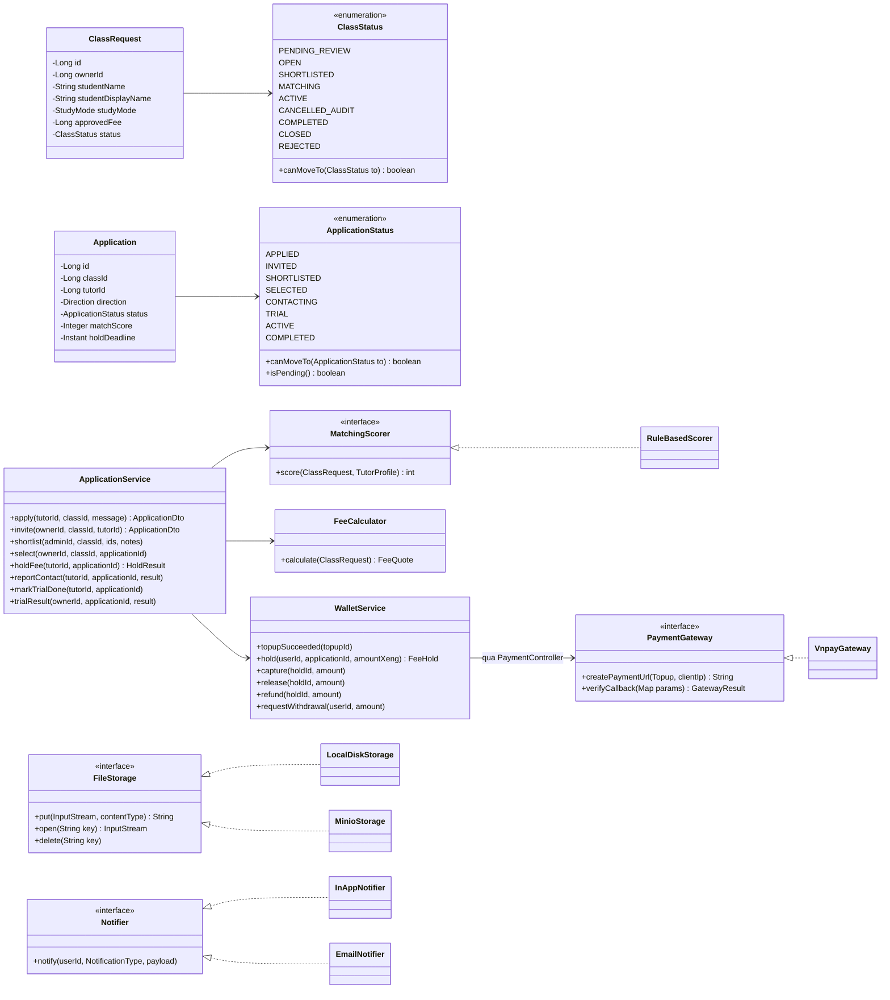

# 05 — Backend (Spring Boot 4, Java 21)

## 1. Cấu trúc package: chia theo tính năng

```
vn.giasu123
├── Giasu123Application.java
├── common/          ProblemDetail + GlobalExceptionHandler, PageResponse, ContentGuard (lọc SĐT/link),
│                    StatusHistory, ClockConfig, cấu hình @Scheduled / ShedLock
├── auth/            AuthController, AuthService, JwtService, JwtAuthFilter, SecurityConfig,
│                    RefreshToken, OneTimeCode, RateLimitFilter (Bucket4j)
├── user/            User, UserRole, UserService, CurrentUser
├── legal/           LegalDocument, UserConsent, LegalService
├── catalog/         Subject, Area (danh mục môn học, địa giới)
├── tutor/           TutorProfile, TutorDocument, TutorService, TutorController, FileStorage
├── classrequest/    ClassRequest, ClassStatus, ClassRequestService, ClassRequestController, DisplayNameResolver
├── application/     Application, ApplicationStatus, ApplicationService, MatchingScorer, RuleBasedScorer
├── wallet/          Wallet, WalletTransaction, FeeHold, WalletService (mọi thao tác sổ cái), FeeCalculator,
│                    RefundPolicyService, WithdrawalRequest, PayoutAccount
├── payment/         Topup, PaymentGateway, VnpayGateway, VnpaySigner, PaymentController (tạo lệnh nạp, IPN, return)
├── report/          Report, AuditFlag, ReportService
├── notification/    Notification, Notifier, InAppNotifier, EmailNotifier, DomainEvents
├── admin/           Admin*Controller (/api/admin/**): việc cần làm, duyệt, shortlist, rút xèng, cấu hình
└── jobs/            ExpiryJobs, ReconciliationJob, DocumentCleanupJob
```

Mỗi package tính năng có đủ **Entity, Repository, Service, Controller, `dto/`**.
Luồng gọi luôn là `Controller → Service → Repository`. Controller không bao giờ gọi thẳng Repository.
Package này chỉ được gọi **Service công khai** của package khác, không đụng vào Repository của nhau. Ví dụ `ApplicationService` gọi `WalletService.hold(...)`.

## 2. Class diagram: các thành phần chính



## 3. Quy ước code

| Chủ đề | Quy ước |
|--------|---------|
| Chuyển trạng thái | `status.canMoveTo(to)` → repository `@Modifying @Query("update ... where id = :id and status = :from")` → nếu 0 dòng thì ném `ConflictException` (409) → ghi `StatusHistory` |
| Transaction | `@Transactional` đặt ở Service. Thao tác ví luôn `findByIdForUpdate` (`@Lock(PESSIMISTIC_WRITE)`) |
| Giới hạn 5 đơn | Trong cùng transaction: khóa dòng `tutor_profiles` của gia sư → đếm đơn đang chờ → mới được insert |
| DTO | Java `record`, viết tay `static from(entity)`. DTO công khai **không có** trường 🔒. Tách `ClassPublicDto` và `ClassOwnerDto` |
| Lỗi | Ném exception nghiệp vụ có `code` (`CLASS_ALREADY_MATCHED`, `INSUFFICIENT_XENG`...). `GlobalExceptionHandler` chuyển thành `ProblemDetail` |
| Thời gian | Mọi chỗ dùng `Instant.now(clock)` với bean `Clock` được inject. **Cấm** gọi `LocalDateTime.now()` trực tiếp |
| Sự kiện | Service publish domain event, ví dụ `ApplicationSelected`. Listener `@TransactionalEventListener(AFTER_COMMIT)` gửi thông báo/email |
| Nội dung tự do | `ContentGuard.check(text)`: nếu khớp mẫu rõ ràng (SĐT, zalo.me, link, email) thì trả 400; nếu nghi ngờ thì lưu kèm cờ và tạo `AuditFlag` |
| Tên hiển thị | `DisplayNameResolver`: lấy từ cuối của họ tên, bỏ khoảng trắng thừa, tạo "Bạn {givenName}". Admin sửa được khi duyệt |
| Cấu hình | `app_settings` đọc qua `SettingsService` (có cache ngắn). Không hard-code 24h, 6h... trong code |

## 4. Chấm điểm shortlist (`RuleBasedScorer`, 0–100)

| Tiêu chí | Trọng số | Cách tính |
|----------|---------|-----------|
| Khớp môn | 35 | Tỉ lệ số môn của lớp mà gia sư dạy được |
| Khu vực | 20 | OFFLINE: cùng `area` = 20, cùng tỉnh = 10. ONLINE: luôn 20 nếu gia sư có dạy online |
| Học phí | 15 | `expected_fee ≤ approved_fee` = 15; vượt dưới 20% = 8; còn lại = 0 |
| Yêu cầu có cấu trúc | 15 | Khớp giới tính mong muốn + loại gia sư mong muốn (ANY thì tính đủ điểm) |
| Kinh nghiệm | 10 | min(năm kinh nghiệm, 5) × 2 |
| Độ tin cậy | 5 | 5 − strike_count (không âm) |

Điểm được lưu vào `applications.match_score` và dùng để sắp xếp danh sách cho admin. **Admin là người quyết định**, điểm số chỉ để gợi ý.
Sau này có thể đo chất lượng gợi ý bằng: tỉ lệ admin giữ nguyên top-3 theo điểm, và tỉ lệ phụ huynh chọn đúng người có điểm cao nhất.
