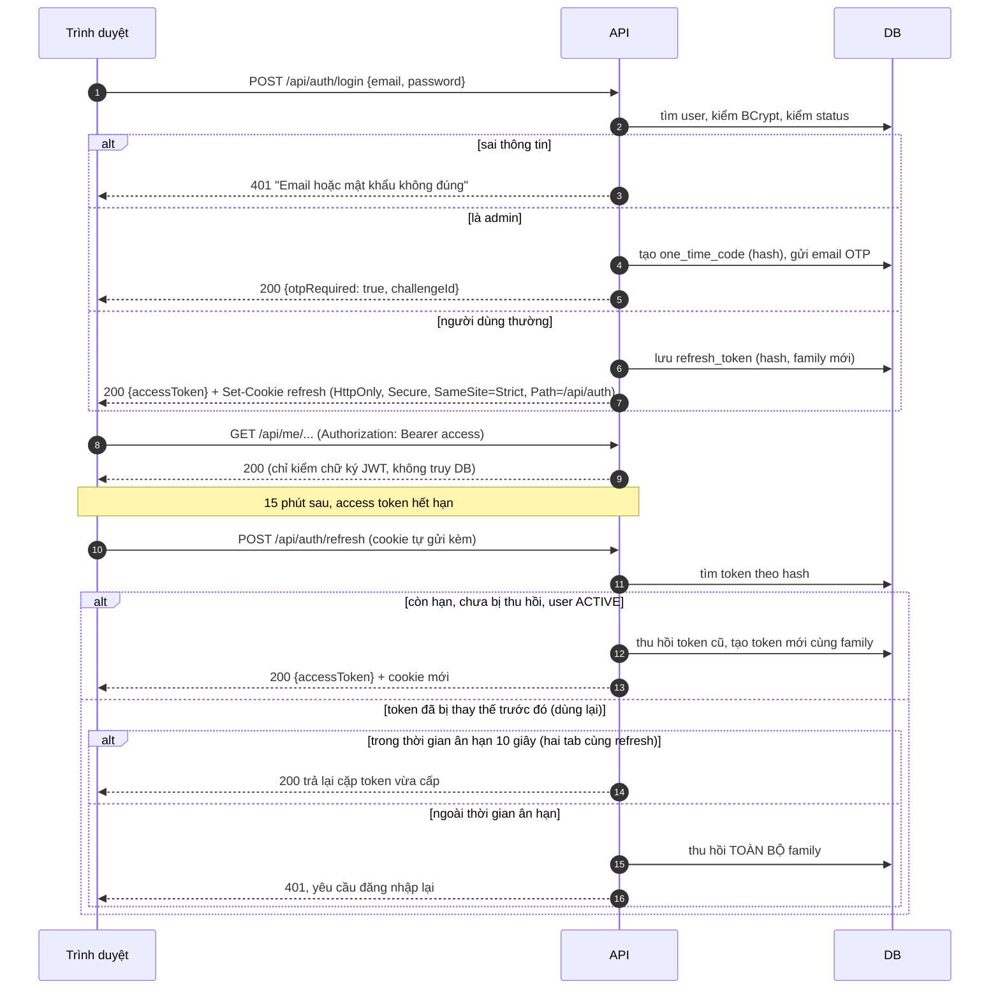
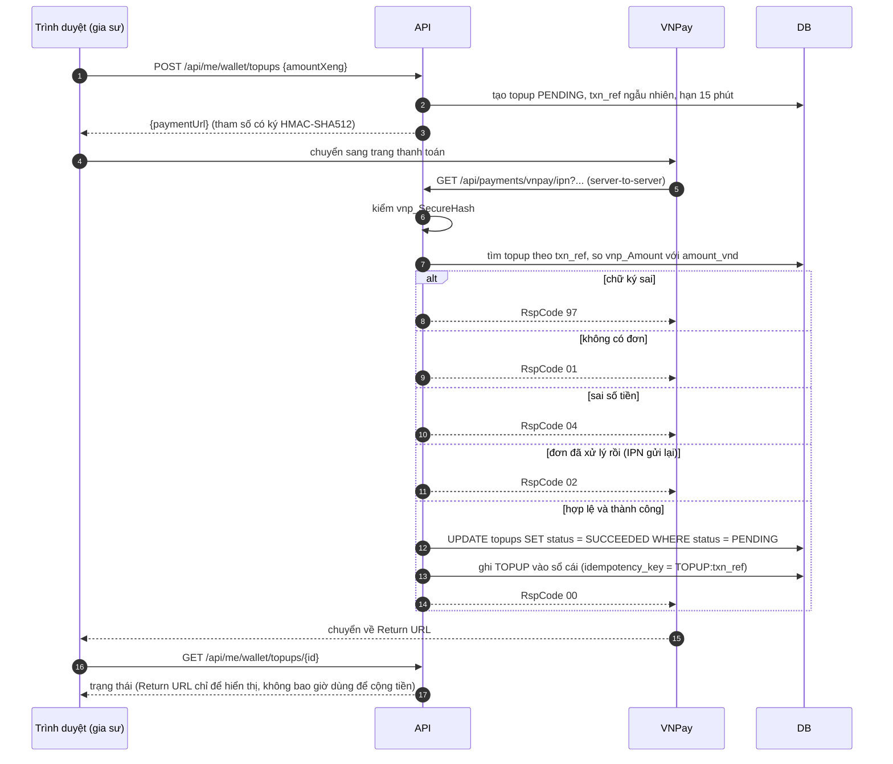

# 06 — Bảo mật

## 1. Threat model: bảo vệ cái gì, trước ai

| Tài sản | Kẻ tấn công / rủi ro | Biện pháp chính |
|---------|---------------------|-----------------|
| 💰 Xèng, trạng thái giữ phí, doanh thu | Giả mạo IPN; gửi trùng IPN; race condition; nạp bằng thẻ ăn cắp rồi rút ra | Kiểm HMAC + số tiền + idempotency; UPDATE có điều kiện; sổ cái chỉ thêm dòng; chỉ rút về tài khoản đã xác thực |
| 📞 SĐT, địa chỉ, họ tên học sinh | Gia sư muốn né phí; kẻ thu thập dữ liệu; kẻ xấu nhắm vào trẻ em | DTO công khai không có trường 🔒; chỉ trả ra sau HOLD; chặn SĐT trong ô chữ tự do; danh sách chỉ hiện "Bạn {tên}" và phường/xã |
| 🪪 Ảnh CCCD | Đánh cắp danh tính | Kho file riêng tư, tên file ngẫu nhiên, chỉ admin xem qua API, ghi log mỗi lần xem, tự xóa sau 30 ngày |
| 🔑 Tài khoản (nhất là admin) | Dò mật khẩu, XSS lấy token, chiếm phiên | BCrypt(10), rate limit, access token 15 phút lưu trong bộ nhớ, refresh token httpOnly có rotation, OTP cho admin, CSP |

## 2. Xác thực

### 2.1 Đăng nhập, gọi API, refresh token

- **Access token:** JWT HS256, sống 15 phút, chứa `sub`, `roles`, `tutorVerified`. Frontend chỉ giữ trong bộ nhớ (Zustand), **không** ghi vào `localStorage`.
- **Tải lại trang:** app khởi động thì gọi `/api/auth/refresh` ngay. Frontend chỉ cho **một** lời gọi refresh chạy tại một thời điểm (single-flight), các request khác xếp hàng chờ.
- **Khóa tài khoản / đăng xuất:** thu hồi mọi refresh token của user. Người dùng bị văng ra muộn nhất sau 15 phút.
- **Admin:** refresh token sống 8 giờ. Mỗi lần đăng nhập đều phải nhập OTP email (6 số, hạn 5 phút, dùng một lần, tối đa 5 lần sai). Email admin phải có 2FA riêng.
- **Chống dò email:** đăng nhập sai luôn trả cùng một thông báo. Đăng ký, gửi lại xác thực, quên mật khẩu đều trả "Nếu email hợp lệ, chúng tôi đã gửi hướng dẫn".

### 2.2 Nạp xèng qua VNPay

Khi dev: IPN không gọi tới được `localhost`, nên dùng `cloudflared tunnel`, hoặc endpoint `/api/dev/vnpay/simulate-ipn` **chỉ bật ở profile `dev`**. Endpoint này tự ký tham số bằng khóa sandbox.

## 3. Phân quyền

Hai lớp kiểm tra:
1. **Theo URL và vai trò** trong `SecurityConfig`.
2. **Theo chủ sở hữu** trong Service: truy vấn luôn kèm id người gọi, ví dụ `findByIdAndOwnerId`. Nếu không tìm thấy thì trả **404**, không phải 403, để không lộ rằng tài nguyên đó có tồn tại.

| Nhóm endpoint | Khách | Thành viên | + đã xác thực email | Gia sư VERIFIED | Admin |
|---------------|:----:|:----------:|:-------------------:|:---------------:|:-----:|
| `GET /api/classes`, `/api/tutors`, `/api/subjects`, `/api/areas`, `/api/legal/*` | ✓ | ✓ | ✓ | ✓ | ✓ |
| `/api/auth/*` | ✓ | ✓ | ✓ | ✓ | ✓ |
| `/api/me/**` (hồ sơ, thông báo, ví của mình) | | ✓ | ✓ | ✓ | ✓ |
| Đăng lớp, mời gia sư, chọn gia sư, báo cáo | | | ✓ chủ lớp | ✓ | |
| Ứng tuyển, giữ xèng, báo liên hệ, rút xèng | | | | ✓ | |
| Xem liên hệ của một đơn | | | chủ lớp của đơn, sau HOLD | gia sư của đơn, sau HOLD | ✓ |
| `/api/admin/**` | | | | | ✓ + OTP |
| `GET /api/payments/vnpay/ipn` | công khai, nhưng bắt buộc chữ ký hợp lệ | | | | |

## 4. Kiểm soát đầu vào và đầu ra

- **Validate** bằng Bean Validation trên DTO request (`@NotBlank`, `@Size`, `@Min/@Max`, `@Pattern`). Giới hạn kích thước body 1MB (riêng upload file là 5MB).
- **Ô chữ tự do** (`bio`, `message`, `requirements`, lý do kết thúc lớp) đi qua `ContentGuard`: mẫu rõ ràng thì trả 400, mẫu nghi ngờ thì gắn cờ.
- **Chỉ văn bản thuần:** không nhận HTML/Markdown. React tự escape. **Cấm** dùng `dangerouslySetInnerHTML`. App admin chỉ dùng các field hiển thị text.
- **Upload giấy tờ:** kiểm tra magic bytes (chỉ nhận JPEG/PNG/PDF), tối đa 5MB, giới hạn kích thước pixel. Ảnh được **mã hóa lại** để xóa EXIF (có thể chứa GPS). Tên file ngẫu nhiên, lưu ngoài web root.
- **SQL:** chỉ dùng Spring Data hoặc JPQL có tham số. Cấm nối chuỗi SQL.
- **Log:** che SĐT, email, số tài khoản. Không bao giờ log mật khẩu, token, OTP.

## 5. Rate limit (Bucket4j, sau này thêm Nginx `limit_req`)

| Endpoint | Giới hạn |
|----------|----------|
| `POST /api/auth/login`, `/login/otp` | 5 lần/phút theo IP + 10 lần/giờ theo email |
| `POST /api/auth/register`, gửi lại email | 3 lần/giờ theo IP |
| `POST /api/classes/{id}/applications`, tạo lớp | 20 lần/giờ theo user |
| `POST /api/me/wallet/topups` | 10 lần/giờ theo user |

Vượt giới hạn thì trả 429 kèm `Retry-After`. Khi chạy nhiều instance, bucket phải chuyển sang kho dùng chung (Redis hoặc PostgreSQL).

## 6. Header và CORS

- Dùng mặc định của Spring Security, cộng thêm: `Content-Security-Policy: default-src 'self'; img-src 'self' data:; frame-ancestors 'none'`, `Referrer-Policy: strict-origin-when-cross-origin`, HSTS khi đã có HTTPS.
- CORS: về nguyên tắc **không cần**, vì cả hai app gọi `/api` cùng origin qua proxy. Khi dev chỉ cho phép `http://localhost:5173` và `http://localhost:5174`.
- CSRF: các API dùng Bearer token nên không bị ảnh hưởng. Cookie refresh có `SameSite=Strict` và `Path=/api/auth`.

## 7. Dữ liệu cá nhân (Nghị định 13/2023)

- **Đồng ý qua clickwrap:** hai checkbox riêng, không tick sẵn (Điều khoản; Xử lý dữ liệu cá nhân). Gia sư đồng ý thêm Nội quy nhận lớp. Hệ thống lưu `user_consents` gồm phiên bản, thời điểm, IP. Khi văn bản có phiên bản mới, người dùng phải đồng ý lại.
- **Tối thiểu hóa:** danh sách công khai chỉ hiện tên gọi và phường/xã. CCCD bị xóa sau 30 ngày kể từ khi xác minh.
- **Quyền xóa:** tài khoản bị xóa thì ẩn danh hóa thông tin cá nhân, giữ lại giao dịch để đối soát.
- **Nhật ký truy cập** dữ liệu nhạy cảm: `document_access_logs`.

## 8. Checklist OWASP Top 10 (2021)

| Hạng mục | Biện pháp trong thiết kế | Test |
|----------|-------------------------|------|
| A01 Broken Access Control | Phân quyền 2 lớp, trả 404 cho tài nguyên của người khác, DTO tách theo quyền | Test IDOR cho mọi endpoint `/api/me/**` và endpoint thao tác trên đơn |
| A02 Cryptographic Failures | BCrypt; chỉ lưu hash của token/OTP; HTTPS + HSTS; secret nằm trong biến môi trường | Kiểm tra DB không có token ở dạng rõ |
| A03 Injection | Truy vấn có tham số; Bean Validation; chỉ văn bản thuần + CSP | Test gửi payload SQLi/XSS |
| A04 Insecure Design | Máy trạng thái, UPDATE có điều kiện, partial unique index, sổ cái bất biến | Test chạy song song (race) |
| A05 Security Misconfiguration | Header mặc định; tắt stack trace trong response; Actuator chỉ mở `health` | ZAP baseline |
| A06 Vulnerable Components | Dependabot / `npm audit` / OWASP dependency-check trong CI | CI thất bại nếu có CVE Critical |
| A07 Identification & Auth Failures | Rate limit, OTP admin, refresh rotation + phát hiện dùng lại, thông báo lỗi chung chung | Test brute-force, test dùng lại refresh token |
| A08 Software & Data Integrity | Kiểm chữ ký IPN; khóa phiên bản thư viện (lockfile) | Test IPN giả mạo |
| A09 Logging & Monitoring Failures | `status_history`, log truy cập tài liệu, log có correlation id, cảnh báo khi đối soát lệch | Test đối soát |
| A10 SSRF | Không có tính năng tải file từ URL (bỏ hẳn "avatar bằng URL") | — |
