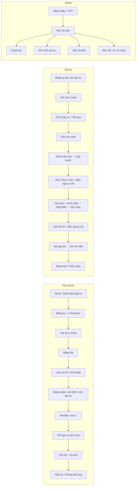

# 08 — Frontend (Web app + Admin app) và đề bài cho Figma

> File này là **đề bài để thiết kế trên Figma**. Mỗi trang trong sitemap = ít nhất 1 frame Desktop (1440) + 1 frame Mobile (390).
> ⚠️ **Navbar đã chốt thiết kế** — chỉ được thay **vùng nút auth** khi đã đăng nhập (mục 4.1). Top bar, logo, menu, màu giữ nguyên.

## 1. Design token (lấy từ code hiện có)

| Token | Giá trị | Dùng cho |
|-------|---------|----------|
| `color.primary` | `#24725D` | Top bar, nút chính, link active, icon |
| `color.primary-soft` | `#E8F5F1` / `#E3F2EB` | Nền section bạc hà, chip nhẹ |
| `color.primary-border` | `#B9D8CD` | Viền nhẹ |
| `color.accent` | `#FF6B35` | Hộp social, điểm nhấn, số liệu thống kê |
| `color.accent-soft` | `#FFF1EA` / `#FFF4EC` / `#FCE7DA` | Nền hero kem |
| `color.ink` | `#15384A` | Chữ tiêu đề đậm |
| `color.success / warning / danger / info` | Tailwind `green-600 / amber-500 / red-600 / sky-600` | Chip trạng thái, thông báo *(đề xuất mới)* |
| `font.family` | Be Vietnam Pro | Toàn site |
| `radius.pill` | `rounded-full` | Nút, chip, ô tìm kiếm |
| `radius.card` | `rounded-2xl` / `rounded-xl` | Card, modal |
| `container` | `max-w-[1336px]` | Khung nội dung |

> CLAUDE.md cũ ghi "blue-600 / green-600" — **không khớp UI thật**; từ nay dùng bảng token trên. Trong Figma tạo **Variables/Styles** đúng tên token này trước khi vẽ.

## 2. Sitemap

Chú thích: **Có** = đã có UI · **Sửa** = có nhưng phải đổi · **Mới** = chưa có.
Giữ nguyên các đường dẫn Navbar đang trỏ tới (`/tutors`, `/students`, `/login`, `/register-tutor`) để **không phải sửa Navbar**; URL thân thiện SEO (`/gia-su/toan/ha-noi`) để giai đoạn deploy, khi đó cần xin phép sửa link Navbar.

### Web app (`localhost:5173`)
| Route | Trang | Trạng thái | Quyền | Lát |
|-------|-------|-----------|-------|-----|
| `/` | Home | **Sửa** (mock → API; StudentCard mới; ẩn sao đánh giá) | Khách | R1a |
| `/tutors` | Danh sách gia sư | **Mới** | Khách | R1a |
| `/tutors/:id` | Chi tiết gia sư (+ nút "Mời dạy lớp của tôi") | **Mới** | Khách | R1a/b |
| `/students` | "Học sinh cần gia sư" = danh sách **lớp** | **Mới** | Khách | R1a |
| `/students/:id` | Chi tiết lớp (+ nút "Ứng tuyển") | **Mới** | Khách | R1a/b |
| `/login` | Đăng nhập | **Mới** | Khách | R1a |
| `/register-tutor` | **Đăng ký tài khoản** (giữ 2 tab "Tôi cần tìm gia sư" / "Tôi muốn làm gia sư" — chỉ khác trang chuyển tới sau đăng ký) | **Sửa** (tách phần thông tin lớp ra) | Khách | R1a |
| `/verify-email` | Xác thực email (kết quả + gửi lại) | **Mới** | Khách | R1a |
| `/legal/terms` · `/legal/privacy` · `/legal/tutor-rules` · `/safety` | Điều khoản, Chính sách, Nội quy nhận lớp, Hướng dẫn an toàn | **Mới** | Khách | R1a |
| `/me` | Tổng quan (việc cần làm của tôi) | **Mới** | Thành viên | R1a |
| `/me/classes` · `/me/classes/new` · `/me/classes/:id` | Lớp của tôi · Đăng lớp (tái dùng phần "Thông tin lớp học" của RegisterTutor) · Chi tiết lớp của tôi | **Mới** | Thành viên | R1a–c |
| `/me/tutor-profile` | Hồ sơ gia sư (tạo/sửa/gửi xác minh/giấy tờ) | **Mới** | Thành viên | R1a/d |
| `/me/applications` · `/me/applications/:id` | Đơn nhận lớp · Chi tiết đơn (giữ xèng, liên hệ, học thử) | **Mới** | Gia sư | R1b–c |
| `/me/wallet` · `/me/wallet/topups/:id` | Ví xèng · Kết quả nạp | **Mới** | Thành viên | R1c |
| `/me/notifications` · `/me/reports` · `/me/settings` | Thông báo · Báo cáo của tôi · Tài khoản + đồng ý pháp lý | **Mới** | Thành viên | R1b–c |
| `*` | 404 + trang lỗi chung | **Mới** | — | R1a |

### Admin app (`localhost:5174`, react-admin, layout sidebar riêng — không dùng Navbar công khai)
| Route | Trang | Lát |
|-------|-------|-----|
| `/login` | Đăng nhập + bước OTP | R1a |
| `/` | **Việc cần làm** (thẻ đếm + danh sách ưu tiên) | R1a–c |
| `/classes` · `/classes/:id` | Duyệt lớp (checklist gọi điện, chốt giá, sửa tên gọi), lịch sử trạng thái | R1a |
| `/tutors` · `/tutors/:id` | Xác minh gia sư, xem giấy tờ | R1a/d |
| `/classes/:id/shortlist` | Ứng viên sắp theo điểm → chọn 2–3 + lý do | R1b |
| `/reports` · `/audit-flags` | Báo cáo (SAFETY đầu), cờ nghi vấn + ghi kết quả gọi khảo sát | R1c |
| `/withdrawals` · `/wallets` · `/reconciliation` | Rút xèng, sổ cái, đối soát | R1c |
| `/users` · `/settings` | Khóa/mở TK · phí, chính sách hoàn, app settings, văn bản pháp lý | R1a–c |

## 3. User flow



## 4. Wireframe khung chữ (dựng lại trên Figma)

Mỗi màn hình gọi API **bắt buộc có 3 trạng thái**: *Loading* (skeleton cùng bố cục), *Lỗi* (thông điệp dễ hiểu + nút "Thử lại"), *Rỗng* (minh họa + CTA).

### 4.1 Navbar — vùng auth khi đã đăng nhập (vùng DUY NHẤT được đổi)
```
Chưa đăng nhập (giữ nguyên):   [Đăng nhập]  ( Đăng ký )
Đã đăng nhập:                  🔔³   ( 🪙 1.160 xèng )*   (👤 Minh ▾)
                                                          ├ Lớp của tôi
  * chỉ hiện khi là gia sư                                ├ Đơn nhận lớp        (gia sư)
                                                          ├ Hồ sơ gia sư / Trở thành gia sư
                                                          ├ Ví xèng
                                                          ├ Thông báo · Báo cáo của tôi
                                                          ├ Cài đặt tài khoản
                                                          └ Đăng xuất
```
Mobile: chuông + avatar giữ trên thanh, menu thả xuống toàn chiều rộng.

### 4.2 Card lớp (thay StudentCard — không họ tên, không số nhà)
```
┌───────────────────────────────────────────────┐
│ #L1024                          [Đang tuyển]  │
│ Bạn An (nam) · Lớp 12                          │
│ 📘 Toán, Lý        🏠 Dạy tại nhà              │
│ 📍 Phường Dịch Vọng, Hà Nội                    │
│ 🗓 3 buổi/tuần · 90 phút/buổi                  │
│ ✨ Ưu tiên gia sư nữ, có kinh nghiệm luyện thi │
│ 200.000đ/buổi              ( Xem chi tiết )    │
└───────────────────────────────────────────────┘
```

### 4.3 Chi tiết lớp (công khai)
```
[Breadcrumb]  Học sinh cần gia sư › #L1024
Bạn An · Lớp 12 · [Đang tuyển] · Đăng 2 ngày trước · 4 gia sư đã ứng tuyển
┌─ Thông tin lớp ───────────────┐  ┌─ Phí nhận lớp ─────────────────────┐
│ Môn, hình thức, lịch, khu vực │  │ Học phí: 200.000đ/buổi             │
│ Yêu cầu gia sư                │  │ 200.000 × 3 × 4 × 40% = 960 xèng   │
│ Ghi chú của phụ huynh         │  │ (Giữ 100% khi được chọn,           │
└───────────────────────────────┘  │  hoàn theo Nội quy nhận lớp ↗)     │
                                   │ ( Ứng tuyển ngay )                 │
                                   │ Chưa là gia sư? Trở thành gia sư → │
                                   └────────────────────────────────────┘
Modal Ứng tuyển: lời nhắn (≤500 ký tự, cảnh báo nếu có SĐT/link) · "Bạn đang có 3/5 đơn chờ"
```

### 4.4 Lớp của tôi — chi tiết (phức tạp nhất phía phụ huynh)
```
#L1024 Bạn An · Lớp 12                                   [Đang chọn gia sư]
Timeline: Đăng ─ Duyệt ─ Tuyển ─ ●Shortlist ─ Giữ phí ─ Học thử ─ Đang học
┌─ Shortlist admin đề xuất ──────────────────────────────────────────────┐
│ (Ảnh) Cô Hương · 5 năm · Toán, Lý · Phù hợp 86%                         │
│   "Chuyên luyện thi, cùng phường, đúng yêu cầu gia sư nữ"  ( Chọn )     │
│ (Ảnh) Thầy Khoa · 8 năm · ...       Phù hợp 81%              ( Chọn )   │
│                                         [ Yêu cầu danh sách khác ]      │
└────────────────────────────────────────────────────────────────────────┘
Các trạng thái khác của khung chính:
- Chờ duyệt: "Admin sẽ gọi cho bạn để xác nhận trong giờ làm việc"
- Chờ gia sư giữ phí: tên gia sư + đếm ngược 24h
- Đã giữ phí: thẻ liên hệ gia sư (SĐT) + nút "Đã liên hệ được"
- Học thử: sau khi gia sư báo dạy thử → 2 nút "Tiếp tục học" / "Không phù hợp" + đếm ngược 48h
- Đang học: nút "Kết thúc lớp" (modal lý do) · Báo cáo vi phạm (mọi lúc)
Sidebar: Mời gia sư (tìm theo tên/môn, còn 2/3 lời mời) · Đóng lớp · Gia hạn
```

### 4.5 Đơn nhận lớp — chi tiết (phía gia sư)
```
Lớp #L1024 · Bạn An · Lớp 12                                  [Được chọn]
⏳ Còn 18:42:10 để giữ phí
┌─ Phí nhận lớp ──────────────────────────────────────────┐
│ 200.000 × 3 × 4 × 40% = 960 xèng                         │
│ Ví: 620 xèng khả dụng → Thiếu 340 xèng                   │
│ ( Nạp 340 xèng = 340.000đ qua VNPay )                    │
│ ☐ Tôi đã đọc chính sách hoàn phí (Nội quy v3)            │
│ ( Giữ 960 xèng và nhận liên hệ )   ← disabled khi thiếu  │
└──────────────────────────────────────────────────────────┘
Sau khi giữ: thẻ liên hệ (Họ tên PH, SĐT, địa chỉ) + ⏳ 6h:
   ( Đã liên hệ ) ( Không liên lạc được )
Học thử: ( Tôi đã dạy buổi thử ) → "Chờ phụ huynh xác nhận ⏳ 48h"
Đang dạy: ( Báo cáo ) ( Bỏ lớp — không hoàn phí )
```

### 4.6 Ví xèng
```
┌ Khả dụng: 1.160 xèng ┐ ┌ Đang giữ: 960 xèng ┐   ( Nạp xèng ) ( Rút xèng )
Bộ lọc loại giao dịch · Bảng: Thời gian | Loại | Lớp/Đơn | +/- khả dụng | +/- đang giữ | Số dư sau
Modal nạp: nhập số xèng hoặc chọn gói 100/200/500 → "= 340.000đ" → chuyển VNPay
Trang kết quả nạp: Đang xử lý (poll 3s) → Thành công / Thất bại (không dựa vào Return URL)
```

### 4.7 Đăng ký (`/register-tutor`)
```
[ Tôi cần tìm gia sư ] [ Tôi muốn làm gia sư ]      ← giữ 2 tab của thiết kế cũ
Họ tên · Email · Mật khẩu (👁) · Nhập lại mật khẩu (👁) · SĐT
☐ Tôi đồng ý Điều khoản dịch vụ (v1) ↗
☐ Tôi đồng ý Chính sách xử lý dữ liệu cá nhân (v1) ↗        ← 2 ô riêng, không tick sẵn
( Tạo tài khoản )
→ Màn "Kiểm tra email để xác thực" → sau xác thực: tab 1 → Đăng lớp · tab 2 → Hồ sơ gia sư
```

### 4.8 Admin — Việc cần làm + Duyệt lớp
```
[Lớp chờ duyệt 7] [Hồ sơ chờ xác minh 3] [Cần shortlist 4] [Báo cáo 2 (1 SAFETY)] [Cờ nghi vấn 1] [Rút xèng 2]
Bảng ưu tiên: SAFETY → quá hạn → cũ nhất

Duyệt lớp #L1031:
  Thông tin đầy đủ (họ tên, SĐT, địa chỉ) · cờ nội dung (nếu có)
  ☐ Đã gọi xác nhận phụ huynh   Ghi chú cuộc gọi: [________]
  Tên hiển thị: [Bạn An]   Học phí PH đề xuất: 180.000 / "Nhờ tư vấn"
  Học phí chốt: [200.000] đ/buổi   → Phí dự kiến: 960 xèng
  ( Duyệt )   ( Từ chối… lý do )
```

## 5. Thư viện component cần có trong Figma (và trong code)

Button (primary pill xanh · secondary viền · accent cam · danger · text) · Input/Select/Textarea/Checkbox/Radio (có trạng thái lỗi) ·
**StatusChip** (mỗi trạng thái 1 màu: xám=chờ, xanh dương=đang xử lý, cam=cần hành động/đếm ngược, xanh lá=thành công, đỏ=thất bại) ·
Card lớp · Card gia sư · Timeline/Stepper · **Countdown** · Modal xác nhận · Toast · Pagination · EmptyState · Skeleton · Avatar · Badge "Đã xác minh" · Bảng dữ liệu (admin).

## 6. Quy ước code frontend

| Chủ đề | Quy ước |
|--------|---------|
| Cấu trúc | `src/features/{auth,classes,tutors,applications,wallet,notifications,legal}/` chứa `pages/`, `components/`, `api.js` (hooks TanStack Query); `src/components/common` giữ Navbar/Footer/UI dùng chung. Chuyển dần, không dời hàng loạt |
| Gọi API | Một axios instance (`services/api.js`): gắn Bearer; khi 401 → **single-flight refresh** rồi gửi lại; refresh thất bại → logout. Query key dạng `['classes', filters]` |
| Auth state | Zustand: `{ user, accessToken }` **trong bộ nhớ**, không `localStorage`; khởi động app gọi `/api/auth/refresh` |
| Form | react-hook-form + zod; schema zod mô phỏng validate backend; lỗi `errors` của ProblemDetail gắn vào `setError(field)` |
| Route guard | `RequireAuth`, `RequireVerifiedEmail`, `RequireTutor` (chỉ để UX — backend mới là chốt chặn) |
| Hiển thị | Tiền `Intl.NumberFormat('vi-VN')` + "đ"; xèng "1.160 xèng"; ngày giờ theo `Asia/Ho_Chi_Minh`; enum → nhãn tiếng Việt qua 1 file `labels.js` |
| Bảo mật | Cấm `dangerouslySetInnerHTML`; không lưu token/PII vào `localStorage`; không log dữ liệu nhạy cảm ra console |
| A11y | Mọi input có `<label>`; focus thấy được; tương phản AA; icon có `aria-label`; modal bẫy focus |

### 6b. Quy ước gọi backend (đã áp dụng trong code, 2026-10-12)

```
Component ──dùng──▶ hook (features/x/api.js) ──▶ xApi.fn() ──┬─ VITE_USE_MOCK≠false ─▶ features/x/mock.js
                                                              └─ VITE_USE_MOCK=false ─▶ services/api.js (axios) ─▶ /api
```

| # | Quy tắc | File |
|---|---------|------|
| 1 | **Một axios instance**: gắn Bearer từ store; 401 → refresh **single-flight** rồi gửi lại đúng 1 lần; mọi lỗi ném ra là `ApiError` (chuẩn hóa ProblemDetail) | `services/api.js`, `lib/problem.js` |
| 2 | **Mỗi feature có `api.js`**: hàm thuần (1 hàm = 1 endpoint ở 07-api.md) + hook TanStack Query + `xKeys` (query key gom 1 chỗ) | `features/*/api.js` |
| 3 | **Component không import axios hay mock** — chỉ dùng hook | — |
| 4 | Mock trả **đúng hình dạng DTO** (phân trang `{items,page,size,totalItems,totalPages}`, enum UPPER_SNAKE, lỗi ProblemDetail). `?mockError=1` để xem trạng thái lỗi | `features/*/mock.js`, `lib/mockKit.js` |
| 5 | Form: react-hook-form + zod (`features/*/schemas.js`); lỗi 400 của backend → `applyServerErrors(err, setError)` | `lib/problem.js` |
| 6 | Mọi màn có dữ liệu bọc `<QueryState>` → đủ loading / lỗi + Thử lại / rỗng | `components/ui/states.jsx` |
| 7 | Bộ lọc + trang nằm trên URL (`useUrlFilters`); bộ lọc URL → tham số backend đổi trong `toServerParams()` | `lib/useUrlFilters.js` |
| 8 | Danh mục (tỉnh, môn, lớp), nhãn enum, format tiền/ngày, token màu: **mỗi thứ 1 nguồn** | `constants/*`, `lib/format.js`, `index.css @theme` |
| 9 | Chuyển hướng sau đăng nhập luôn qua `safeRedirect()` (chống open redirect) | `lib/safeRedirect.js` |

**Nối backend thật:** đặt `VITE_USE_MOCK=false` trong `frontend/.env.local`, rồi chạy lại toàn bộ luồng. Chỗ cần sửa khi backend có `/api/areas`: `toServerParams()` đổi `provinceName` → `provinceId`.

## 7. Quy trình Figma

1. `npm run dev` → dùng plugin **html.to.design** (kèm Chrome extension vì plugin không đọc được `localhost`) để import **Home** và **RegisterTutor** hiện có làm bản gốc (khóa layer Navbar/Footer — thiết kế đã chốt).
2. Tạo **Variables** theo bảng token (mục 1) + **Components** (mục 5), dọn layer sau khi import (đặt tên, auto-layout).
3. Vẽ theo **thứ tự lát**: R1a (Navbar vùng auth, Đăng ký, Đăng nhập, Xác thực email, Danh sách/Chi tiết lớp & gia sư, Đăng lớp, Lớp của tôi, Hồ sơ gia sư, Admin: Việc cần làm / Duyệt lớp / Xác minh) → R1b → R1c.
4. Mỗi trang: Desktop 1440 + Mobile 390 + các trạng thái Loading / Lỗi / Rỗng.
5. Khi Figma MCP đã kết nối vào phiên Claude Code: Claude đọc frame để **review UX** và đối chiếu tài liệu, sau đó cắt thành component React theo quy ước mục 6.
