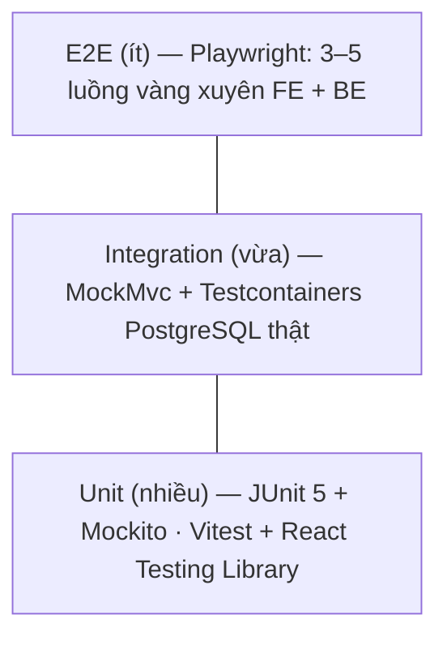

# 09 — Chiến lược kiểm thử ("đo, không tuyên bố")

## 1. Tháp test



| Tầng | Công cụ | Test cái gì | Không test gì |
|------|---------|-------------|---------------|
| Unit backend | JUnit 5, Mockito, AssertJ | `canMoveTo` của mọi enum trạng thái, `FeeCalculator`, `RuleBasedScorer`, `ContentGuard`, `DisplayNameResolver`, `RefundPolicyService`, `VnpaySigner` | Truy vấn SQL, Spring wiring |
| Integration backend | Spring Boot Test, MockMvc, **Testcontainers (PostgreSQL 16)**, Flyway chạy thật | Endpoint + phân quyền, ràng buộc DB (partial unique index, trigger sổ cái), transaction + khóa dòng, job với `Clock` giả, IPN | Giao diện |
| Unit frontend | Vitest + React Testing Library + MSW (giả API) | Form (zod + lỗi backend), 3 trạng thái loading/lỗi/rỗng, nhãn enum, format tiền, route guard, single-flight refresh | Chi tiết CSS |
| E2E | Playwright (đã cài) | Đăng ký→xác thực→đăng lớp→admin duyệt; ứng tuyển→shortlist→chọn→nạp (IPN giả lập)→giữ xèng→học thử→CAPTURE | Mọi nhánh lỗi (đã có ở tầng dưới) |
| Tải | **k6** | `GET /api/classes`, `GET /api/tutors` có lọc; luồng đăng nhập | — |
| Frontend chất lượng | Lighthouse CI | Performance, Accessibility, Best practices | — |
| Bảo mật | OWASP ZAP baseline, Dependabot / `npm audit` | Header, lỗi cấu hình, CVE phụ thuộc | — |

## 2. Quy tắc viết test

- **Given / When / Then** trong [02-use-cases.md](02-use-cases.md) → mỗi dòng là 1 test; tên test mô tả hành vi: `select_whenAnotherTutorAlreadySelected_returns409`.
- **Không dùng `Thread.sleep` hay chờ thời gian thật**: inject `Clock`, test dùng `MutableClock` để "tua" 24h / 6h / 48h.
- **Test race condition thật**: 2 luồng (`ExecutorService` + `CountDownLatch`) cùng chọn 2 đơn / cùng giữ xèng / IPN trùng → khẳng định chỉ 1 thành công và DB nhất quán.
- **Mỗi thay đổi tiền → kiểm bất biến sổ cái** (helper `assertLedgerConsistent()` chạy cuối mọi test ví).
- **Mọi endpoint `/api/me/**` và thao tác trên đơn có test IDOR**: user B gọi tài nguyên của A → 404.
- Test DB dùng Testcontainers (không H2) — cùng PostgreSQL với production, để partial index, `FOR UPDATE`, `unaccent` hoạt động thật.

## 3. Danh sách test bắt buộc theo lát (rút gọn)

| Lát | Test tiêu biểu |
|-----|----------------|
| R1a | đăng ký chưa tick đủ 2 checkbox → 400 · email trùng → thông báo chung · đăng nhập sai 6 lần/phút → 429 · refresh dùng lại ngoài ân hạn → thu hồi family · admin thiếu OTP → không vào `/api/admin/**` · chưa xác thực email → đăng lớp 403 · ContentGuard chặn "0912 345 678" và "zalo.me/..." · danh sách lớp công khai **không có** trường 🔒 |
| R1b | đơn chờ thứ 6 → 409 `APPLICATION_LIMIT` (kể cả gửi song song) · gia sư ứng tuyển lớp của mình → 409 · lời mời thứ 4 → 409 · 2 lựa chọn song song → 1 thành công · job 24h → `EXPIRED` + strike · điểm `RuleBasedScorer` đúng bảng trọng số |
| R1c | IPN chữ ký sai → 97 · sai số tiền → 04 · IPN lặp → 02, số dư không đổi · thiếu xèng → 409 kèm `shortfall` · HOLD rồi 6h không báo → `TRIAL` + mất quyền hoàn · im lặng 48h → CAPTURE · quota lần 3 → 80/20 · miễn quota khi `WRONG_CONTACT` · kết thúc ngày 10 → hoàn 50% · rút xèng bị từ chối → `WITHDRAW_REVERSAL` · đối soát phát hiện bút toán lệch · `UPDATE`/`DELETE` trên `wallet_transactions` → lỗi |
| R1d | upload file đổi đuôi `.jpg` nhưng là PDF/EXE → 400 · ảnh sau upload không còn EXIF · job xóa CCCD sau 30 ngày · xem giấy tờ ghi `document_access_logs` |

## 4. Kịch bản k6 (mục tiêu ở [00-overview.md](00-overview.md#6-yêu-cầu-phi-chức-năng-đề-xuất-ban-đầu-sẽ-đo-bằng-k6-và-lighthouse))

```js
// k6/classes-list.js — chạy: k6 run k6/classes-list.js
import http from 'k6/http';
import { check, sleep } from 'k6';

export const options = {
  stages: [
    { duration: '30s', target: 50 },
    { duration: '1m',  target: 100 },
    { duration: '30s', target: 0 },
  ],
  thresholds: {
    http_req_duration: ['p(95)<300'],   // mục tiêu NFR
    http_req_failed:   ['rate<0.01'],
  },
};

export default function () {
  const page = Math.ceil(Math.random() * 5);
  const res = http.get(`${__ENV.BASE_URL}/api/classes?provinceId=1&page=${page}&size=10`);
  check(res, { 'status 200': (r) => r.status === 200 });
  sleep(1);
}
```
Dữ liệu seed cho đo tải: ≥ 5.000 lớp, 1.000 gia sư (script seed riêng, **không** nằm trong migration). Ghi kết quả (p95, RPS, tỉ lệ lỗi, cấu hình máy) vào bảng kết quả trong file này mỗi lần đo.

| Ngày | Kịch bản | Cấu hình | p95 | RPS | Lỗi | Ghi chú |
|------|----------|----------|-----|-----|-----|---------|
| — | — | — | — | — | — | chưa đo |

## 5. CI (GitHub Actions — R1d)
`push` / `pull_request` → `./mvnw verify` (unit + Testcontainers) → `npm ci && npm test && npm run build` (web + admin) → `npm audit --audit-level=critical` → báo cáo coverage (JaCoCo). Merge vào `main` chỉ khi CI xanh.
